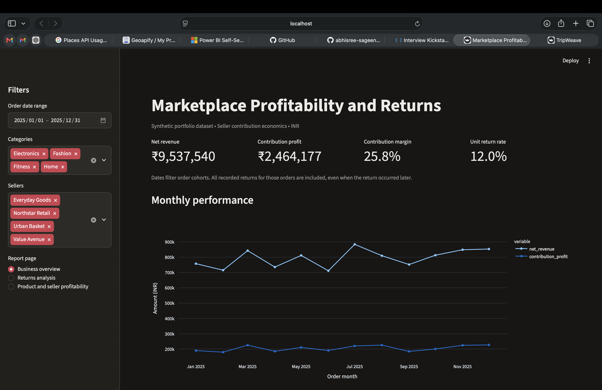
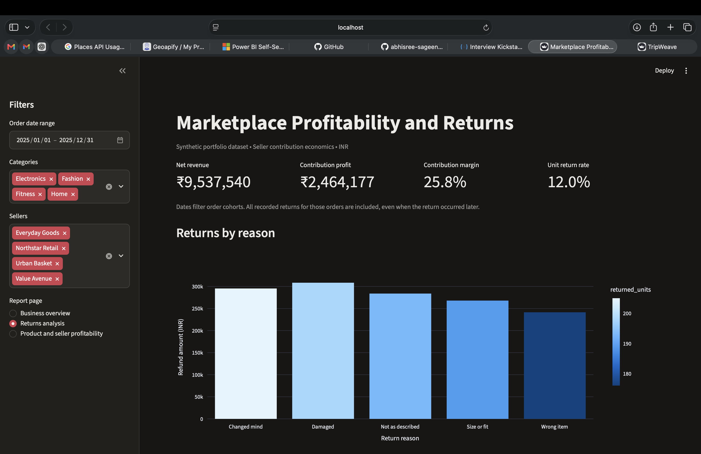

# Marketplace Profitability and Returns

A seller profitability analysis project built with Python, Pandas,
DuckDB SQL, Streamlit, and Plotly.

## Business problem

High sales do not always translate into strong contribution profit.

This project investigates how discounts, refunds, product costs,
marketplace fees, and delivery expenses affect product and seller
profitability.

## Dashboard






## Workflow

1. Generate reproducible synthetic source data with Python.
2. Validate identifiers, return quantities, refunds, and dates.
3. Aggregate return events in SQL before joining to orders.
4. Calculate order-level contribution economics.
5. Explore results through an interactive Streamlit report.

## Dataset

- 4,000 synthetic orders across 2025.
- Eight products across four categories.
- Four fictional sellers.
- One product line per order.
- Full and partial quantity returns.
- Some orders have multiple return events.
- All currency values are INR.

Data is generated using a fixed random seed.

## Metrics

- Net revenue = paid sales - refunds.
- Net product cost = original product cost - recovered inventory cost.
- Contribution profit = net revenue - net product cost -
  marketplace fees - outbound shipping - return shipping.
- Contribution margin = total contribution profit / total net revenue.
- Unit return rate = returned units / units sold.

## Assumptions

- Analysis uses the seller perspective.
- Marketplace fees reverse proportionally with refunds.
- Restockable returns recover original inventory cost.
- Taxes, fixed overhead, and subsequent inventory resale are excluded.
- Date filters select order cohorts and include all recorded returns
  associated with those orders.
- Synthetic patterns demonstrate analytical methods and are not
  evidence about an actual marketplace.

## Validation

- Unique source identifiers.
- Valid product, seller, and order references.
- Returned quantities do not exceed purchased quantities.
- Refunds do not exceed paid amounts.
- Return dates follow order dates.
- SQL preserves one row per order.
- Source sales and refunds reconcile with analytical totals.
- Contribution profit reconciles with its components.

## Run locally

Use the Python version recorded in the repository's setup notes.

```bash
python3 -m venv .venv
source .venv/bin/activate
python -m pip install -r requirements.txt
python generate_data.py
python -m streamlit run app.py
```

## Project files

- `generate_data.py` generates and validates source data.
- `sql/profitability.sql` calculates order profitability.
- `app.py` provides the interactive dashboard.
- `data/` contains reproducible synthetic source files.
- `screenshots/` contains report previews.
- `requirements.txt` records Python dependencies.

## Findings

After running the dashboard, record three observations here.

For each observation, include the selected filters, the measured
result, an interpretation, and a proposed follow-up analysis.